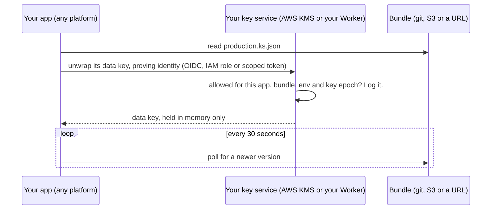

<p align="center">
  
</p>

<h1 align="center">keyseal</h1>

<p align="center">
  <strong>Secrets your app unlocks at runtime, through a key service you own.</strong><br>
  Nothing that opens them is stored on your hosting platform.
</p>

<p align="center">
  <a href="https://github.com/ownkube/keyseal/actions/workflows/ci.yml"></a>
  <a href="https://www.npmjs.com/package/@ownkube/keyseal"></a>
  <a href="https://www.npmjs.com/package/@ownkube/keyseal#provenance"></a>
  <a href="https://scorecard.dev/viewer/?uri=github.com/ownkube/keyseal"></a>
  <a href="https://www.npmjs.com/package/@ownkube/keyseal"></a>
  <a href="LICENSE"></a>
</p>

<p align="center">
  <a href="#the-problem">The problem</a> ·
  <a href="#how-keyseal-unlocks">How it unlocks</a> ·
  <a href="#key-providers">Key providers</a> ·
  <a href="#quick-start">Quick start</a> ·
  <a href="#compared-with-other-tools">Compared</a> ·
  <a href="#documentation">Docs</a>
</p>

---

## The problem

Your app's secrets usually live in your hosting platform's env var store,
and the platform holds the key to that store. That leaves two gaps:

1. **A leak of the store is a leak of every value.** Encryption at rest
   doesn't help when the key leaks with it, and you can't see who read what.
2. **New values only arrive with a deploy.** If deploys are paused, you
   can't rotate a leaked key.

Encrypting a file in your repo doesn't close the first gap if the key that
opens it sits in the same env store. It just moves the secret.

## How keyseal unlocks

keyseal keeps secrets encrypted in a bundle you commit (or publish to S3 or
any URL). The difference is how the app opens it: **the platform never holds
a key.** At startup the app proves who it is to a key service you own, and
that service decides, logs and can later refuse the unlock.



What that gets you:

- 🔑 **No key on the platform.** With OIDC or workload identity the
  platform stores nothing secret. Otherwise it stores one narrow credential
  that opens one bundle, which you can see used and switch off.
- 🔎 **Every unlock is logged** in CloudTrail or your Worker's logs, with
  the caller, bundle and environment.
- ✂️ **Cut off access without touching the app.** Revoke a credential, or
  bump the key epoch so old copies of a bundle (git history, old S3
  versions, a stale image) stop opening.
- 🔄 **Rotate without a deploy.** Publish a new bundle and running apps
  pick up the new values within the poll interval.

## Key providers

Pick where the key lives. All three use the same bundle format, CLI and
API, and `keyseal rekey` moves a bundle between them.

|                          | **AWS KMS**                          | **Cloudflare Worker**                       | **Local key**                  |
| ------------------------ | ------------------------------------ | ------------------------------------------- | ------------------------------ |
| Good for                 | Apps with an AWS account             | No AWS account; Vercel, Fly, GitHub Actions | Local dev, low-stakes apps     |
| Where the key lives      | KMS, in your AWS account             | A Worker secret, in your Cloudflare account | Your machine and the app's env |
| What the platform stores | Nothing (IAM role or OIDC), or one scoped access key | Nothing (OIDC), or one scoped token | The key itself         |
| If the env store leaks   | ✅ Secrets stay sealed               | ✅ Secrets stay sealed                      | ❌ Every value readable        |
| Audit trail              | CloudTrail, every unlock             | Workers Logs, every request                 | None                           |
| Revoke old bundles       | IAM Deny by key epoch                | `minEpoch` by key epoch                     | Only by changing the key       |
| Cost                     | About $1 a month per key             | Workers free plan                           | Free                           |
| Setup guide              | [docs/aws.md](docs/aws.md)           | [docs/cloudflare.md](docs/cloudflare.md)    | [docs/local.md](docs/local.md) |

Local keys are there so you can start without any cloud account. They keep
secrets out of the repo, but not out of a leaked env store.

## Quick start

```sh
npm install --save-exact @ownkube/keyseal
```

**1. Create a bundle** with the provider you picked:

```sh
# AWS KMS
npx keyseal init secrets/production.ks.json --env production --kms-key alias/keyseal-production --region us-east-1

# Your Cloudflare Worker (deploy it first: docs/cloudflare.md)
npx keyseal init secrets/production.ks.json --env production --worker https://keyseal.acme.workers.dev

# Local key
npx keyseal init secrets/production.ks.json --env production --local
```

**2. Add secrets and commit.** The CLI prints names, never values:

```sh
npx keyseal import secrets/production.ks.json .env.production
npx keyseal set secrets/production.ks.json STRIPE_SECRET_KEY    # hidden prompt
git add secrets/production.ks.json
```

**3. Let the app unlock it.** For KMS, `keyseal policy` prints the IAM
policy for the app's role. For a Worker, it prints the access entry for
your Worker's config. For a local key, `keyseal key` prints the key to pipe
into your platform's env.

```sh
npx keyseal policy secrets/production.ks.json
```

**4. Run.** Use `keyseal run` with any language, or load secrets in code:

```sh
npx keyseal run secrets/production.ks.json --env production -- node server.js
```

```ts
import { createKeyseal, worker, localKey } from "@ownkube/keyseal";
import { awsKms } from "@ownkube/keyseal/aws";
import { s3 } from "@ownkube/keyseal/s3";
import Stripe from "stripe";

const secrets = await createKeyseal({
  source: s3("s3://acme-keyseal/production.ks.json"), // or a file path or URL
  keys: awsKms(), // or worker(), or localKey()
  env: "production",
});

// get() always returns the current value. Rebuild clients that hold one
// when it rotates; no restart or redeploy needed.
let stripe = new Stripe(secrets.get("STRIPE_SECRET_KEY"));
secrets.on("rotated", (e) => {
  if (e.changed.includes("STRIPE_SECRET_KEY")) {
    stripe = new Stripe(secrets.get("STRIPE_SECRET_KEY"));
  }
});
```

The full walkthrough is in [Getting started](docs/getting-started.md), and
[Rotation](docs/rotation.md) covers publishing new values.

## Compared with other tools

Encrypting secrets in a repo isn't new. What differs is who opens them, and
when.

|                                       | Platform env store | dotenvx                       | SOPS                                 | **keyseal**                                   |
| ------------------------------------- | ------------------ | ----------------------------- | ------------------------------------ | --------------------------------------------- |
| What opens the secrets                | The platform's key | A private key in the env store | A KMS, age or PGP key, wherever `sops -d` runs | **The app, through a key service you own** |
| Key stored on the platform            | Yes                | Yes                           | Depends on the deploy step           | **No** (with OIDC or workload identity)       |
| Per-app, per-env unlock policy        | No                 | No                            | Per key                              | **Per bundle, env and key epoch**             |
| Running apps get a rotated value      | After a redeploy   | After a redeploy              | After a redeploy                     | **Within the poll interval**                  |
| Old copies stop opening after rotation | n/a               | Only if the key changes       | Only if the key changes              | **Yes, by key epoch**                         |

SOPS with KMS is the closest in spirit and a fine file encryptor. keyseal
moves the unlock into the running app, scopes it to one bundle and
environment, and adds live rotation and epoch revocation around it.

## Features

- **Reviewable bundles.** Names, versions and rotation times are readable,
  so pull requests and `git log` show what changed. Values never are.
- **Tamper evident.** A MAC covers every field. Ciphertexts can't be moved
  between names, environments or bundles.
- **Grace windows.** The previous value stays valid while you roll over.
- **Rollback protection.** A running process never goes back to an older
  bundle, and `--min-version` covers fresh starts.
- **Works with any language.** `keyseal run` passes secrets to any command
  as env vars, and strips its own credentials from the child.
- **Testable.** `@ownkube/keyseal/testing` seals bundles in memory, with no
  cloud access in unit tests.
- **Safe with AI agents.** The CLI never prints a value unless you ask,
  and there's a [runbook](docs/agent-setup.md) agents can follow.
- **Small and specified.** The core uses only WebCrypto. The format has a
  [spec](spec/FORMAT.md) and conformance vectors, so other languages can
  follow.

## What a bundle looks like

One JSON file per environment:

```json
{
  "keyseal": 1,
  "env": "production",
  "version": 7,
  "secrets": {
    "STRIPE_SECRET_KEY": { "v": 3, "rotatedAt": "2026-03-01T09:58:12Z", "value": "8Jq..." }
  }
}
```

Trimmed; the full format is in [spec/FORMAT.md](spec/FORMAT.md). Each
bundle has its own data key. Values are encrypted with AES-256-GCM, and
the data key is wrapped by your provider's key.

## FAQ

<details>
<summary><strong>Does every request hit my key service?</strong></summary>

<br>

No. A process unlocks once, when it starts. Rotations reuse the data key,
so polling makes no key service calls. With KMS that's about $1 a month per
key; the Worker fits in the Cloudflare free plan. Details are in
[docs/aws.md](docs/aws.md) and [docs/cloudflare.md](docs/cloudflare.md).

</details>

<details>
<summary><strong>What if my key service is down when the app starts?</strong></summary>

<br>

The app can't unlock, so it fails to start, the same as it would without
its env vars. Running processes keep working: they already hold the data
key in memory.

</details>

<details>
<summary><strong>What happens if my platform's env store leaks?</strong></summary>

<br>

With KMS or the Worker and OIDC or workload identity, the store held
nothing that opens your bundles. With a static credential, it held one
scoped credential you can see used in your logs and switch off without a
deploy. The [incident playbook](docs/hardening.md#incident-playbook) walks
through it.

</details>

<details>
<summary><strong>Can someone with repo access read the secrets?</strong></summary>

<br>

Not without an unlock, which your key service checks and logs. Anyone who
*can* unlock a bundle can also seal an edited copy, so write access to the
repo, bucket or URL is what protects it from edits. The
[threat model](spec/THREAT_MODEL.md) covers this.

</details>

## Documentation

| Guide | |
|---|---|
| [Getting started](docs/getting-started.md) | From a `.env` file to an encrypted bundle, step by step. |
| [AWS KMS](docs/aws.md) | IAM policies, credentials per platform, KMS call counts, prices. |
| [Cloudflare Worker](docs/cloudflare.md) | A key service on your Cloudflare account: setup, OIDC, revocation, logs. |
| [Local keys](docs/local.md) | Using keyseal with a key you hold, and what you give up. |
| [Rotation](docs/rotation.md) | Polling S3, publishing from CI, grace windows. |
| [Incidents and hardening](docs/hardening.md) | The leak playbook, revoking old bundles, rollback protection. |
| [Testing](docs/testing.md) | Unit tests without a cloud account, checking a real setup, a rotation drill. |
| [Reference](docs/reference.md) | Every CLI command and flag, the library API, error codes. |
| [Agent runbook](docs/agent-setup.md) | Setup steps for AI coding agents, with checks and stop points. |
| [Threat model](spec/THREAT_MODEL.md) | What keyseal protects against, and what it doesn't. |
| [Format spec](spec/FORMAT.md) | The bundle format and conformance vectors. |

## Security

keyseal is pre-1.0 and has not had an external security review yet. The
[threat model](spec/THREAT_MODEL.md) and [format](spec/FORMAT.md) are open
for review. Releases are published from GitHub Actions with npm
provenance; check them with `npm audit signatures`.

Please report vulnerabilities privately, as described in
[SECURITY.md](SECURITY.md).

## Contributing

Issues and pull requests are welcome. Read
[CONTRIBUTING.md](CONTRIBUTING.md) first; changes to the format start as
an issue.

```
spec/     format spec, threat model, conformance vectors
ts/       @ownkube/keyseal: library and CLI
worker/   the Cloudflare Worker template
docs/     user documentation
```

## License

[MIT](LICENSE) © Ownkube
